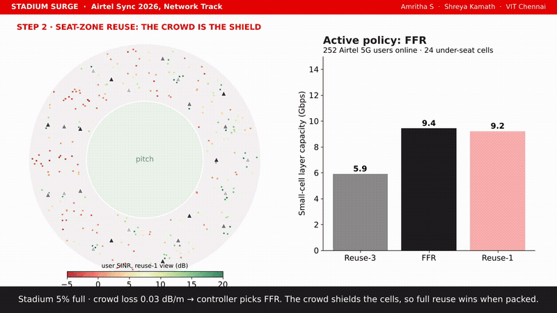

# Stadium Surge

Airtel Sync 2026, Network Track. Amritha S and Shreya Kamath, VIT Chennai.

[Submission deck (PDF)](Airtel_Sync_Stadium_Surge.pdf) | [PPTX](Airtel_Sync_Stadium_Surge.pptx) | [Demo video](docs/demo.mp4) | [Architecture (draw.io)](docs/architecture.drawio)

## Demo

[](docs/demo.mp4)

65 seconds, click the preview for the full video.

## Problem statement

A cricket World Cup final at a 1,00,000-seat stadium is 60 days away. At the last big match (65,000 fans) the network around the stadium choked at the innings break.

| Metric | Normal day | Last match |
|---|---|---|
| 4G anchor (B3) load | ~21% | ~99% |
| 4G user speed | ~16 Mbps | ~1 Mbps |
| 5G connection success | 99% | ~36% |
| UPI failures near the stadium | ~1% | ~7% |

Case inputs: 40% of fans on Airtel, 70% of them with 5G phones, 18% online at peak. Targets of 5 Mbps on 5G and 3 Mbps on 4G at 80% cell load. 100 MHz of n78 and 70 MHz of LTE over three bands. A COW costs ₹25 lakh per event, a small cell ₹8 lakh, fibre ₹50 lakh per km. Budget ₹4 crore.

Tasks:
1. Peak demand and extra 5G / 4G cells at 80% load
2. Mix of COWs, small cells and upgrades within ₹4 crore
3. Keep 5G phones off 4G, protect payments and emergency calls
4. User experience impact and mitigation

## Approach

**Diagnosis.** We started with Airtel's sheet (8 sites, 4 match moments). In all 21 readings where the anchor was saturated, 5G attach sat between 34 and 39%, with a spread of 1.1. M6, the one site that stayed at 60% anchor load, kept 99.2%. That pattern fits an admission limit on B3, so 5G capacity was never the constraint. 4G speed follows r = 20.3(1 - ρ) Mbps across both days (R² = 0.98), which matches the 1 Mbps seen at peak.

**Anchor changes.** B1 and B40 join B3 as NSA anchors, EN-DC phones get reserved anchor room, LTE-only phones move to other bands, and the stadium cluster gets SA on n78. Anchor capacity goes up about 8 times.

**Capacity.** Peak demand is 25.2 Gbps on 5G and 6.5 Gbps on 4G. We add 24 under-seat small cells, 4 COWs and 1.2 km of fibre for ₹3.52 crore, with ₹0.48 crore kept in reserve. Peak load comes out at 62% on 5G and 76% on 4G.

**Seat-zone reuse.** A packed crowd adds body loss at 3.5 GHz (3GPP TR 38.901 blockage model), which isolates the under-seat cells from each other. That lets every cell use the full 100 MHz. Our simulation shows the better scheme depends on how full the stadium is:

| Crowd loss (dB/m) | Reuse-3 | FFR | Reuse-1 |
|---|---|---|---|
| 0 (empty) | 5.7 | **9.5** | 8.5 |
| 0.15 | 6.9 | 10.6 | **10.7** |
| 0.3 (packed) | 7.3 | 11.0 | **12.2** |
| 0.5 | 7.1 | 11.0 | **13.2** |

Capacity in Gbps for 24 cells and 5,040 users, averaged over 5 seeds. The event controller moves from FFR to reuse-1 as ticket scans show the stands filling.

**Payments and 112.** PCC rules put NPCI and bank traffic ahead of video, merchant SIMs get a higher ARP, QCI 1/5 keeps some headroom, AC10 is never barred, and normal users see barring only above 90% load.

## Architecture


Source file: [docs/architecture.drawio](docs/architecture.drawio), two pages, opens in diagrams.net.

## Results

Models fitted on the last match, then run for the final (1.54 times the crowd).

| At peak | Last match | Final, no change | Final, our plan |
|---|---|---|---|
| 5G connection success | 36.4% | 23.8% | **99.2%** |
| 4G user speed | 0.97 Mbps | below 1 Mbps | **4.8 Mbps** |
| 5G user speed | 12 to 28 Mbps | | **about 70 Mbps** |
| UPI failure | 7.1% | about 7% | **about 1.2%** |


| Seat-zone reuse | Link level |
|---|---|
|  |  |

Link level: Gray M-QAM over flat Rayleigh fading, Monte Carlo against the closed form. At 30 dB, 256-QAM gives 0.0197 in simulation and 0.0177 in theory.

## Repository

```
Airtel_Sync_Stadium_Surge.pdf / .pptx   submission deck
docs/      architecture.drawio (+ png, svg), method diagram, demo video
matlab/    full study and the Simulink model builder (see matlab/README.md)
python/    same study in Python
figures/   plots used in the deck
```

## Running

MATLAB (R2019b or later):
```matlab
cd matlab
run_all
```

Python:
```bash
pip install numpy scipy matplotlib openpyxl
python python/airtel_analysis.py Sync_V1.xlsx figures
python python/stadium_reuse_sim.py results.json
```

Sync_V1.xlsx is Airtel's case file and is not part of this repo.

## Assumptions

- Spectral efficiency for sizing: 16 b/s/Hz for 5G massive MIMO, 7 for 5G small cells, 2.5 for LTE. The LTE figure was checked against the last match.
- Crowd body loss of 0.3 dB/m when packed is taken from the blockage literature and has not been measured yet. The reuse result holds for anything above roughly 0.13 dB/m.
- UMi NLOS path loss at 3.5 GHz, under-seat antennas 0.7 m below the handset, interference treated as Gaussian.
- Licence and feature costs are estimates and sit inside the reserve.

## References

- 3GPP TR 38.901, channel model for 0.5 to 100 GHz, section 7.6.8 (human blockage)
- 3GPP TR 36.942, Annex A.2 (SINR to throughput mapping)
- 3GPP TS 38.214, MCS and CQI tables
- 3GPP TS 37.340, EN-DC architecture
- J. G. Proakis, Digital Communications (M-QAM error rate over Rayleigh fading)
