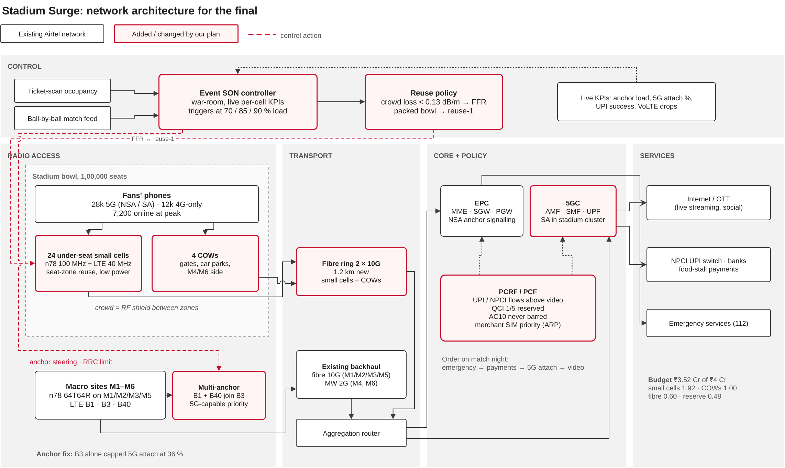
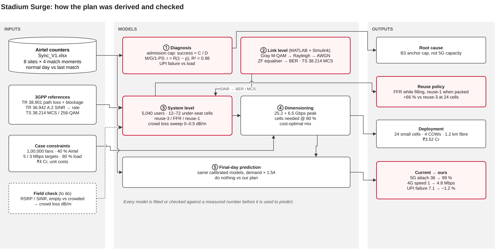
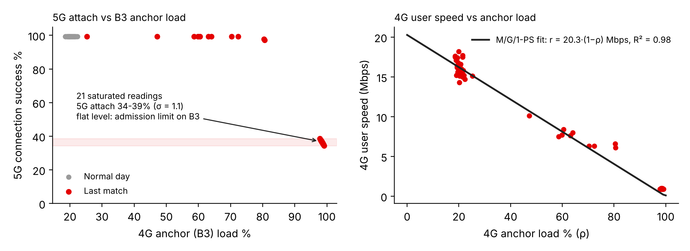
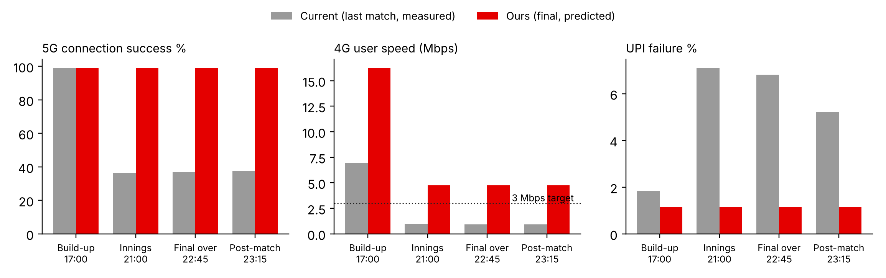
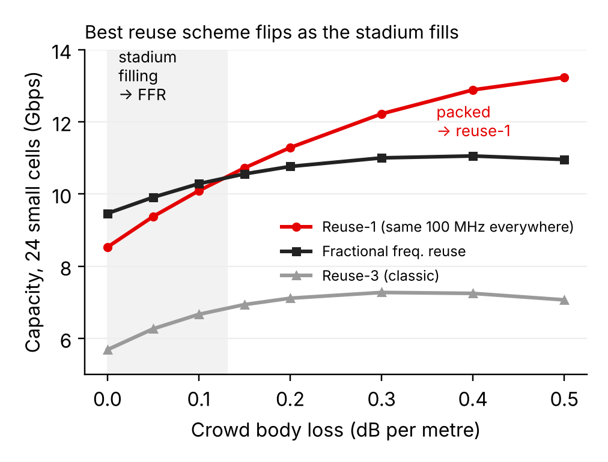
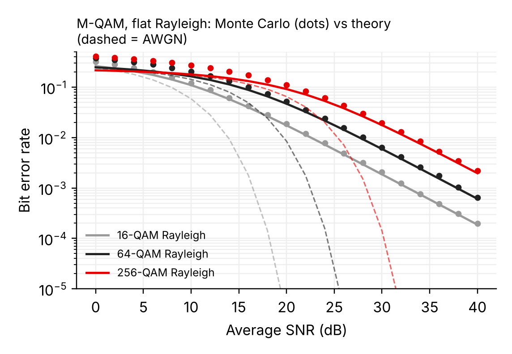

# Stadium Surge

**Airtel Sync 2026, Network Track.** Amritha S and Shreya Kamath, VIT Chennai.

5G and 4G capacity for a 1,00,000-fan cricket final, on a ₹4 crore budget, built from Airtel's own site counters.

---

## Problem statement

A World Cup final at a 1,00,000-seat stadium is 60 days away. At the last big match (65,000 fans), the network around the stadium collapsed at the innings break:

| Metric | Normal day | Last match |
|---|---|---|
| 4G anchor (B3) load | ~21 % | ~99 % |
| 4G user speed | ~16 Mbps | ~1 Mbps |
| 5G connection success | 99 % | ~36 % |
| UPI failures near the stadium | ~1 % | ~7 % |

Inputs from the case: 40 % of fans are on Airtel, 70 % of them have 5G phones, and 18 % are online at the same moment. The targets are 5 Mbps on 5G and 3 Mbps on 4G, with every cell planned at 80 % load. Spectrum is 100 MHz of n78 (3.5 GHz) and 70 MHz of LTE across three bands. A cell on wheels (COW) costs ₹25 lakh per event, a small cell ₹8 lakh and fibre ₹50 lakh per km.

**Tasks**
1. Estimate peak demand and the extra 5G and 4G cells needed at 80 % load.
2. Choose a mix of COWs, small cells and upgrades within ₹4 crore.
3. Stop 5G phones getting stuck on 4G, and protect payments and emergency calls.
4. Describe the impact on user experience and how to mitigate it.

---

## Approach

### 1. Read the counters before adding hardware
Airtel's sheet (8 stadium sites × 4 match moments) shows that the failure was not 5G capacity:

- In all **21 saturated cell-moments**, 5G connection success sits at **34–39 %** (σ = 1.1) while anchor load ranges from 97.8 % to 99.1 %. A flat ceiling like this comes from an admission limit on the B3 anchor, not from gradual congestion. Under a hard cap, success = C/D, so attach demand was **2.7×** anchor capacity.
- Site M6, whose anchor stayed at 60 %, kept **99.2 %** 5G success.
- 4G user speed follows M/G/1 processor sharing, **r = 20.3·(1 − ρ) Mbps**, with **R² = 0.98** across both days. This explains the measured 1 Mbps exactly.

Non-standalone 5G needs the LTE anchor to attach. When B3 filled up, 5G phones fell back to 4G and added about 2,100 users to a layer that was already full.

### 2. Fix the anchor (signalling)
- Add B1 and B40 as anchors alongside B3, reserve anchor room for 5G-capable phones, and steer 4G-only phones to other bands.
- Lower the 5G addition threshold, raise the RRC-connected-user limit, and enable SA on n78 in the stadium cluster.
- Anchor capacity rises about **8×**, enough for the final's 1.54× larger crowd.

### 3. Add capacity where it is cheapest (spectrum reuse)
- Peak demand: 7,200 Airtel users online, **25.2 Gbps on 5G + 6.5 Gbps on 4G**.
- Mix: **24 under-seat small cells + 4 COWs + 1.2 km fibre = ₹3.52 Cr**, with ₹0.48 Cr in reserve.
- Planned peak load is 62 % on 5G and 76 % on 4G.

### 4. Novelty: the crowd is the shield
At 3.5 GHz, human bodies add loss (3GPP TR 38.901 §7.6.8). In a packed bowl this isolates neighbouring under-seat cells, so the same 100 MHz can be reused in every seat zone. The system-level simulation shows the best reuse scheme **flips as the stadium fills**:

| Crowd loss (dB/m) | Reuse-3 | FFR | Reuse-1 |
|---|---|---|---|
| 0 (empty) | 5.7 | **9.5** | 8.5 |
| 0.15 | 6.9 | 10.6 | **10.7** |
| 0.3 (packed) | 7.3 | 11.0 | **12.2** |
| 0.5 | 7.1 | 11.0 | **13.2** |

*Capacity in Gbps, 24 cells, 5,040 users, mean of 5 seeds.*

The event SON controller switches from FFR to reuse-1 as occupancy rises, using ticket scans and the ball-by-ball feed. When packed, that is **+66 %** over classic reuse-3.

### 5. Protect what matters first
UPI and NPCI flows get a QoS rule above video, merchant SIMs get ARP priority, and QCI 1/5 resources are reserved. Emergency calls (AC10) are never barred, and access barring applies to normal users only above 90 % load.

---

## Architecture





The editable source is [`docs/architecture.drawio`](docs/architecture.drawio). It has two pages and opens in diagrams.net.

---

## Results: current vs ours

The same models, calibrated on the last match, are used to predict the final (demand × 1.54).

| KPI at peak | Last match (measured) | Final, do nothing | Final, our plan |
|---|---|---|---|
| 5G connection success | 36.4 % | 23.8 % | **99.2 %** |
| 4G user speed | 0.97 Mbps | under 1 Mbps | **4.8 Mbps** |
| 5G user speed | 12–28 Mbps | — | **~70 Mbps** |
| UPI failure | 7.1 % | ~7 % | **~1.2 %** |




| Seat-zone reuse | Link level |
|---|---|
|  |  |

At the link level, Monte Carlo BER for Gray M-QAM over flat Rayleigh fading matches the closed form (256-QAM at 30 dB: 0.0197 simulated vs 0.0177 theory). 256-QAM needs about 25–30 dB, so every dB of SINR gained from crowd shielding moves more users onto higher-order modulation.

---

## Repository

```
├── Airtel_Sync_Stadium_Surge.pdf / .pptx    submission deck
├── docs/        architecture.drawio, architecture.png/.svg, method.png/.svg
├── matlab/      full study + Simulink model builder (see matlab/README.md)
├── python/      the same study in Python (numpy, scipy, matplotlib)
└── figures/     plots used in the deck
```

## Running

**MATLAB (R2019b or later):**
```matlab
cd matlab
run_all                    % diagnosis, prediction, PHY, reuse study, Simulink
```

**Python:**
```bash
pip install numpy scipy matplotlib openpyxl
python python/airtel_analysis.py Sync_V1.xlsx figures
python python/stadium_reuse_sim.py results.json
```

`Sync_V1.xlsx` is Airtel's case data and is not included in this repository.

---

## Assumptions and limits

- Spectral efficiency used for dimensioning: 5G massive MIMO 16 b/s/Hz, 5G small cell 7, LTE 2.5. The LTE value is cross-checked against the last match.
- The crowd body-loss rate (0.3 dB/m when packed) comes from the blockage literature and still needs field measurement. The crossover result holds for any value above about 0.13 dB/m.
- Path loss is UMi-NLOS style at 3.5 GHz, with under-seat antennas 0.7 m below the handset. Interference is treated as Gaussian.
- Licence and feature costs are estimates, held inside the ₹0.48 Cr reserve.

## References

- 3GPP TR 38.901: channel model for 0.5–100 GHz, §7.6.8 human blockage
- 3GPP TR 36.942: RF system scenarios, Annex A.2 link-to-system mapping
- 3GPP TS 38.214: physical-layer procedures for data, MCS and CQI tables
- 3GPP TS 37.340: EN-DC (NSA) architecture
- J. G. Proakis, *Digital Communications*: M-QAM error probability over Rayleigh fading
